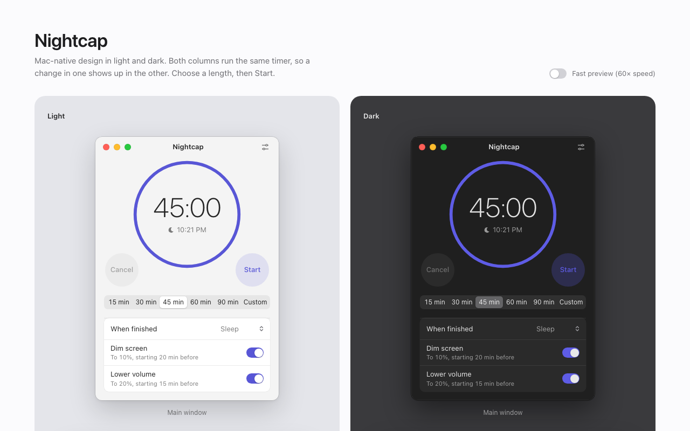

# Nightcap

A sleep timer for your computer, like the one on a TV. Set a time, and Nightcap slowly dims the screen and lowers the volume, then puts the computer to sleep.

Nightcap is built in Rust with [egui](https://github.com/emilk/egui) and runs on macOS, Windows and Linux. It works offline and needs no account.

> **Status:** working desktop app. Timer, fades, menu bar/tray controls, Settings, and overlay fallback are integrated. macOS has been exercised with real brightness and volume fades; Windows has native UI, volume, restoration and overlay checks. Linux is compile-checked. See the platform hardening reports for coverage and limitations.



## Features

- **Sleep timer:** pick 15, 30, 45, 60 or 90 minutes, or set your own length.
- **Screen fade:** dim the screen to a level you choose, starting when you choose, over as long as you choose.
- **Volume fade:** lower the volume the same way, set up separately from the screen fade.
- **When the timer ends:** sleep, hibernate or shut down. Hibernate is shown only
  when a startup check confirms that this machine supports it and the app can request it.
- **Restore:** put brightness and volume back when you cancel the timer or wake the computer.
- **Menu bar and system tray:** start, pause, resume, extend and cancel timers without opening the window. Closing the window keeps the timer running; Open Nightcap brings it back. Quit restores faded levels when restoration is enabled.
- **Overlay fallback:** on displays that don't support brightness control, dim the root window’s monitor with a passive, transparent overlay. It keeps updating while the main window is hidden.
- **Native appearance:** system light/dark theme, runtime system fonts on macOS/Windows, thin countdown digits in fixed-width cells, and separate Settings (gear button or ⌘, on macOS). Preferences are saved in the OS configuration directory.

## Design

The interface follows macOS conventions in light and dark appearance. The mockup in [`docs/design/mockup.html`](docs/design/mockup.html) is interactive: open it in a browser to try the main window, Settings and the menu bar menu.

## Building

You need a recent stable [Rust toolchain](https://rustup.rs).
On Windows, also install the MSVC C++ build tools and Windows SDK described in
the [Rust Windows prerequisites](https://rust-lang.github.io/rustup/installation/windows-msvc.html).

```sh
cargo run
cargo build --release
```

The standalone binary is `target/release/nightcap` (`nightcap.exe` on Windows).
Use a native toolchain on each platform to build its executable. Compile-only
cross-target checks do not produce runnable applications.

For development checks:

```sh
cargo test
cargo clippy --all-targets -- -D warnings
cargo fmt --check
```

On Linux, egui needs a few system libraries. See the [eframe documentation](https://github.com/emilk/egui/tree/main/crates/eframe) for the list.

### Installing on macOS

```sh
scripts/bundle-macos.sh            # builds target/release/bundle/Nightcap.app
scripts/bundle-macos.sh --install  # also copies it to /Applications
```

The bundle is signed ad hoc for local use. Run Nightcap from the bundle rather
than `cargo run` when you want it to appear as itself: macOS lists a bare binary
under the app that launched it (your terminal or editor). The icon source is
`assets/AppIcon.png`, drawn by `scripts/make-icon.swift`.

## Releasing

Releases are cut by [release-please](https://github.com/googleapis/release-please)
(`.github/workflows/release.yml`). Pull requests are squash-merged and titled
with [Conventional Commits](https://www.conventionalcommits.org/): `fix:` makes
a patch release, `feat:` a minor one, and `feat!:` a breaking one (minor while
the version is 0.x). `docs:`, `refactor:`, `test:`, `build:`, `ci:` and `chore:`
make no release. [`AGENTS.md`](AGENTS.md) has the full rules, and the
`PR title` check enforces the format.

After each merge, release-please updates an open release PR that bumps
`Cargo.toml` and `CHANGELOG.md`. Merge it to ship: the workflow tags the
release, runs the tests on each platform, uploads `Nightcap-macOS.dmg`
(universal), `Nightcap-Windows-x64.zip` and `Nightcap-Linux-x86_64.tar.gz` to a
draft release, and publishes it once all three are attached. The asset names
carry no version, so
`https://github.com/ryankegerreis/nightcap/releases/latest/download/<asset>`
always serves the newest build; the marketing site links there. Build the same
DMG locally with `scripts/bundle-macos.sh --universal --dmg`.

The macOS app is signed ad hoc, not with a Developer ID, so Gatekeeper blocks
the first launch: open it once, then choose Open Anyway in System Settings →
Privacy & Security. The Windows build is unsigned and SmartScreen may warn.

## Safe preview and accelerated time

```sh
NIGHTCAP_DRY_RUN=1 NIGHTCAP_SPEED=60 cargo run
```

In Windows PowerShell:

```powershell
$env:NIGHTCAP_DRY_RUN = '1'
$env:NIGHTCAP_SPEED = '60'
cargo run
```

`NIGHTCAP_DRY_RUN=1` replaces all end actions with a log message; no sleep,
hibernation or shutdown is requested. Brightness and volume fades still affect
real hardware. After a dry-run timer ends, use Cancel or Quit to restore levels
when restoration is enabled.

`NIGHTCAP_SPEED=<n>` advances timer and fade time at `n` times real speed. At
`60`, a 15-minute timer finishes in 15 seconds. The displayed end time uses real
wall time, and wake detection stays unscaled. The default is `1`; invalid,
non-finite or non-positive values are logged and fall back to real time. Speed
alone does not disable power actions, so use both variables for previews.

## Platform notes

On macOS, the window has a unified header with native traffic lights. Nightcap
appears in the Dock and Cmd-Tab while its window is visible, then becomes a
menu-bar-only app when the window closes. The menu’s Open Nightcap restores and
focuses the window. Cmd-W hides the main window (or closes Settings); Cmd-Q and
Quit Nightcap exit gracefully. Brightness uses DisplayServices on the primary
display, with an overlay fallback for unsupported displays. Volume uses
CoreAudio, with an AppleScript fallback. Brightness and native audio writes stay
on the device captured at the start of its fade, so changing the primary display
or default audio output cannot redirect restoration. The AppleScript fallback
waits for its captured output to be selected again before restoring it. Hibernate
is hidden because macOS has no public user-level hibernate action. Shutdown can prompt for Automation
permission to control System Events; allow it in System Settings → Privacy &
Security → Automation. The timer itself requires no Accessibility permission.

Windows support targets Windows 10 or later. Volume captures the default CoreAudio
endpoint when a fade starts and keeps writes and restoration on that endpoint.
Brightness uses WMI for supported built-in panels and DDC/CI for supported
external monitors. DDC writes are checked against the reported level; monitors
that accept but ignore writes fall back to the dimming overlay. Windows uses the
OpenGL renderer to support transparent and hidden viewports. Native
window decorations and the notification-area tray are retained. Power actions
depend on Windows privileges and hibernation configuration. Hibernate is offered
only when Windows reports S4 support, a full hibernation file, and access to the
required shutdown privilege; a reduced Fast Startup file is insufficient.

On Linux, the tray needs a D-Bus session with a StatusNotifier host (for example
KDE Plasma, or a compatible GNOME extension). If tray initialization fails,
closing the main window quits instead of leaving an inaccessible background
process. Brightness needs a supported `/sys/class/backlight` device and access
through writable sysfs, logind’s SetBrightness, or `brightnessctl`; otherwise the
overlay is used. Volume tries `wpctl`, `pactl`, then `amixer`. Power actions use
systemd/logind and remain subject to the session’s polkit permissions. Hibernate
is offered only when logind's CanHibernate check returns yes, allowing it without
an authorization prompt. Failed or unavailable checks keep the option hidden. Overlay
placement depends on the window manager; Wayland can select a different output.

The overlay covers one monitor, is always on top, and lets mouse input pass
through. It is a visual fade rather than hardware brightness control. With
restoration disabled, Cancel leaves faded levels in place until changed manually;
the overlay disappears when the app exits. Restoration after sleep uses native
macOS wake notifications and a wall-clock gap of more than 5 seconds after the
end action (30 seconds while the timer is running or paused). Real power actions
and Windows/Linux desktop behavior require testing on the corresponding systems.

Capability checks run once when the app launches. If a saved Hibernate preference
is unavailable, Nightcap changes it to Sleep. Restart Nightcap after changing
hibernation configuration or permissions. The OS can still reject a power action
if its configuration or permissions change after startup.

## License

Licensed under either of

- Apache License, Version 2.0 ([LICENSE-APACHE](LICENSE-APACHE))
- MIT license ([LICENSE-MIT](LICENSE-MIT))

at your option.

Unless you explicitly state otherwise, any contribution you intentionally submit for inclusion in this work, as defined in the Apache-2.0 license, is dual licensed as above, without any additional terms or conditions.

The [macOS hardening report](docs/macos-hardening.md) records feature coverage,
opt-in hardware checks, and remaining platform limitations.

Windows has read-only native discovery checks in `cargo test`. To exercise real
brightness and volume changes, close other Nightcap instances and run this
opt-in test alone:

```powershell
cargo test --locked --test windows_runtime -- --ignored --nocapture --test-threads=1
```

The hardware test always substitutes dry-run power actions, restores captured
levels on exit, and verifies overlay state when hardware brightness is unavailable.
Keep the connected displays and selected audio output unchanged during this test.
It does not test actual suspend, hibernation, shutdown, or physical reconnection.
The [Windows hardening report](docs/windows-hardening.md) records the native test
run, reproduced issues and remaining limitations.
